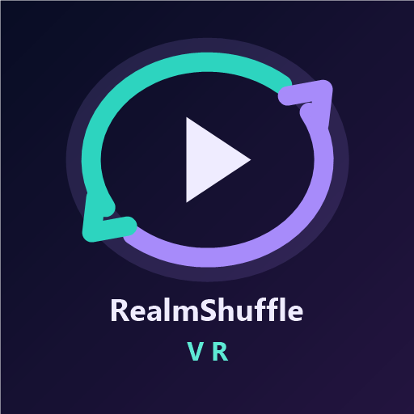

# RealmShuffle VR

An independent open-source fork of [Immivio](https://github.com/NorthBoundWisdom/immivio), designed for continuous immersive VR media sessions on Meta Quest 3.

**Status:** 0.7.3 Lite development source, installed and startup-verified on Quest 3. The stable branch remains at 0.7.2. Public APK distribution is pending dependency and licensing review. Other headsets have not been validated for this fork.

## Features

- Adaptive shuffle without repeating scenes within a shuffle round.
- Videos shorter than four minutes loop toward a five-minute viewing session; longer videos play their natural duration.
- Independent randomized music and optional scene-matched soundtrack synchronization.
- Adjustable binaural audio, peaceful transitions, persistent session zoom and orientation.
- Controller navigation and a performance monitoring overlay.
- Persistent local video and music usage journals with navigation reasons and periodic checkpoints.
- Reduced panorama texture dimensions; the tested APK is 120.63 MiB, down from 170.75 MiB (29.35%).
- Standalone operation with locally supplied media, without a connected PC.

## Getting started

The current source uses local media under `/sdcard/Movies/RealmShuffle/Videos` and `/sdcard/Movies/RealmShuffle/Music`. Supply your own authorized VR180 side-by-side videos and audio. The project does not distribute commercial VR experiences or their soundtracks.

- [RealmShuffle controls](docs/REALMSHUFFLE-CONTROLS.md)
- [Build and packaging notes](docs/REALMSHUFFLE-BUILD.md)
- [Development roadmap](docs/REALMSHUFFLE-ROADMAP.md)
- [Original Immivio documentation](docs/IMMIVIO-README.md) (upstream features, not all independently verified in this fork)

## Attribution and licensing

Based on Immivio 1.0.2 by NorthBoundWisdom, commit `10f5bb87d628e84e53af0cf5054b522bdb15a137`. Immivio continues from [Thru3D Media Player](https://github.com/zerochocobo/Thru3D-Media-Player). Original history, credits and [GPL-3.0-only license](LICENSE) are retained. See [upstream licensing details](docs/LICENSING.md) for third-party components. RealmShuffle is independently maintained by schex86 and is not an official Immivio release.

The six modified Godot scripts, their remaps, two optimized textures and two texture remaps were rebuilt with Godot 4.7.2 and matched all 16 targeted resources in the installed 0.7.3 Lite APK byte for byte. This verifies targeted resources, not complete native dependency correspondence. Manual previous-navigation and panorama visual acceptance remain pending.
